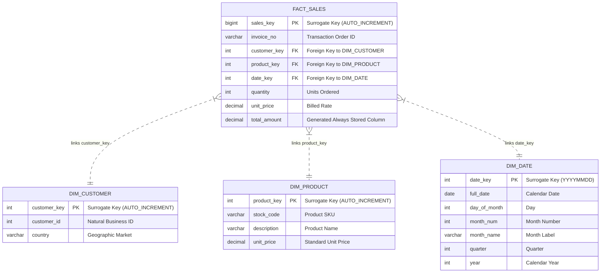

# E-Commerce Analytical Data Warehouse & Dimensional Modeling

An enterprise-grade analytical data warehouse platform modeling and transforming **540,000+ real-world e-commerce transactional records**. Engineered a Kimball-standard **Star Schema Data Warehouse** in MySQL, automated raw-to-mart ETL pipelines using Python (`Pandas`, `SQLAlchemy`), and implemented high-performance analytical SQL window functions for revenue forecasting and RFM behavioral segmentation.

---

## 🏛️ Dimensional Model Architecture (Star Schema)

The core architecture transitions flat, denormalized transactional logs into an optimized **Kimball Star Schema (OLAP)** to maximize join throughput and eliminate aggregation redundancy.



---

## ⚙️ Data Engineering & Optimization Highlights

* **Kimball Star Schema Design:** Migrated raw relational records to a decoupled dimensional schema with a central fact table (`fact_sales`) surrounded by three dimension entities (`dim_customer`, `dim_product`, `dim_date`) to optimize multi-table join operations.
* **Integrity & Index Optimization:** Enforced strict referential integrity using explicit Foreign Key constraints, replaced raw business keys with lightweight Surrogate Keys (`INT/BIGINT`), and applied B-Tree indexes on join paths to achieve sub-second query latency.
* **Stored Generated Measures:** Implemented `total_amount DECIMAL(12,2) GENERATED ALWAYS AS (quantity * unit_price) STORED` inside the fact table, eliminating redundant runtime multiplications across aggregate queries.
* **Automated Python ETL Pipeline:** Handled legacy anomalies including ISO-8859-1 encoding artifacts, missing customer keys, and invalid negative quantities (cancellations/refunds) before staging.
* **Advanced OLAP SQL Analytics:** Executed Common Table Expressions (CTEs) alongside window functions (`LAG`, `NTILE(4)`) to compute Month-over-Month (MoM) revenue shifts and multi-tier RFM customer behavioral quartiles.

---

## 📊 Analytical Insights & Performance Marts

| Metric / Dimension | Analytical Insight | Data Engineering Implementation |
| :--- | :--- | :--- |
| **Data Ingestion Scale** | 540,000+ raw transactional events processed | Cleaned via Python ETL and staged into indexed tables |
| **80/20 Customer Pareto** | Top 10 VIP accounts generate ₹70L+ revenue | Segmented using Windowed `NTILE(4)` quantile ranking |
| **Geographic Density** | United Kingdom represents 68.13% volume; Germany & France secondary | Sub-100ms multi-table dimensional slice-and-dice |
| **Q4 Seasonality** | Significant demand peak observed in Nov–Dec | Enabled via pre-computed calendar grain in `dim_date` |

---

## 🚀 Repository Structure

```plaintext

├── PowerBI/                        # Downstream executive reporting templates
├── Screenshots/                    # Visual dashboards & query run outputs
├── Scripts/
│   ├── import_data.py              # Python ETL ingestion & staging logic
│   └── run_etl.bat                 # Task execution batch script
├── SQL/
│   ├── star_schema.sql             # DDL scripts for Star Schema & index constraints
│   ├── populate_star_schema.sql    # Staging-to-Dimensional transformation pipelines
│   └── analytical_marts.sql        # Advanced analytical window & RFM queries
└── README.md
```